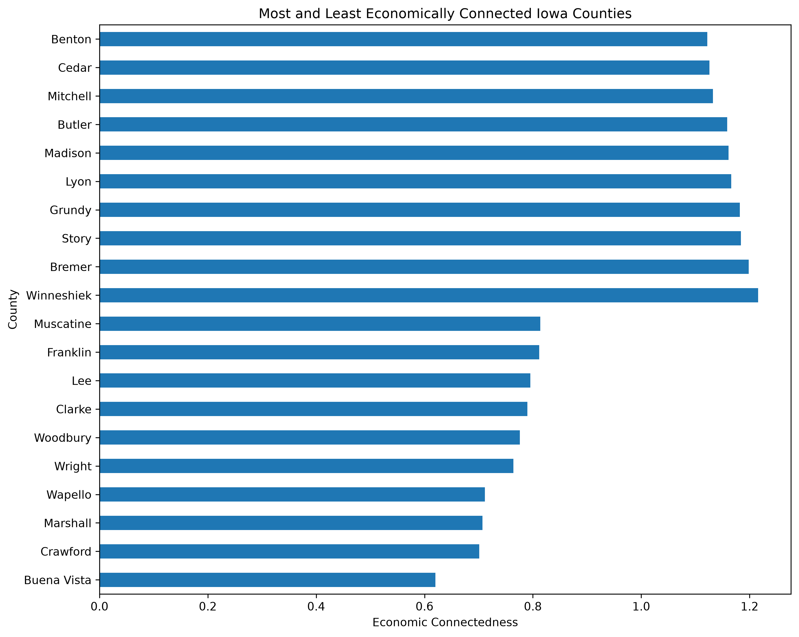
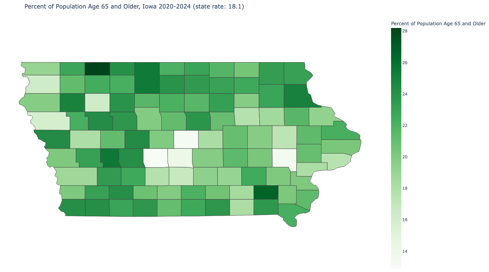
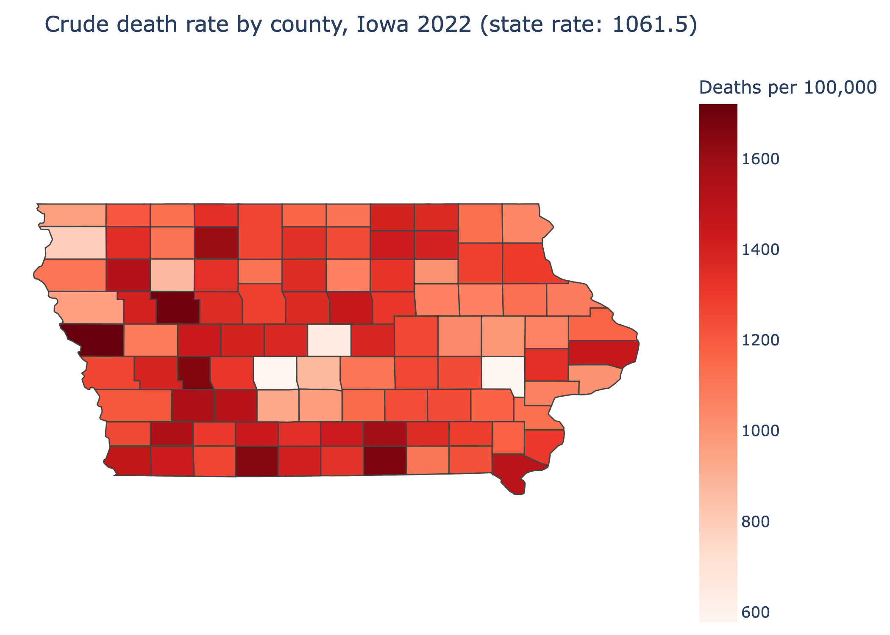
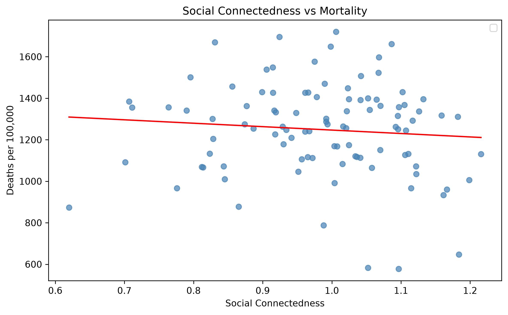
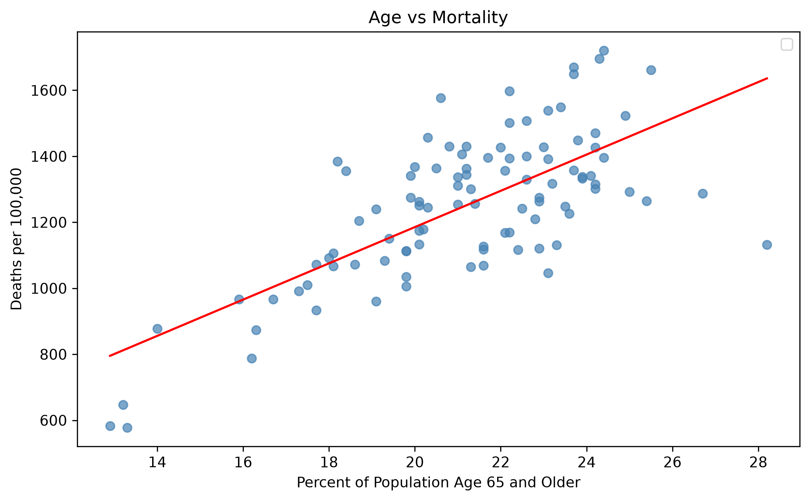

# Hawkeye Mortality Midterm
####  Group: Hawkeye Mortality 
Julia Kapusta, Kendall Curry, and Kevin Szybist
## Project Overview
The goal of our project is to investigate the relationship between social connectedness and mortality rates. We chose to focus our initial analysis on counties in Iowa because they have relatively little variation in population size, land area, and population density. This allows for more consistent comparisons across counties. Additionally, we chose to incorporate county-level age data into our exploration because age is one the primary factors associated with mortality. By accounting for differences in age across counties, we hope to better understand whether a statistically significant relationship exists between social connectedness and mortality rates. 

## Data
Our project uses three county level datasets to investigate the relationship between social connectedness and mortality rates across Iowa's 99 counties. These datasets provide information on economic connectedness, mortality, and the proportion of residents aged 65 and older. 

### Data Sources 
The datasets used in this project were obtained from publicly available sources:
- Social Capital: Opportunity Insights, Social Capital Atlas. This dataset provides county level economic connectedness measures.
- Mortality: Centers for Disease Control and Prevention (CDC), Underlying Cause of Death, 2018-2024, Single Race. This dataset provides county level mortality information.
- Population Aged 65 and Older: County level age data used to examine differences in the elderly population across Iowa counties. The original source and reference year will be added once confirmed.

### Economic Connectedness
Economic connectedness measures the extent to which individuals from lower socioeconomic backgrounds form friendships with individuals from higher socioeconomic backgrounds. According to Opportunity Insights, economic connectedness is calculated as twice the average share of higher socioeconomic status friends among lower socioeconomic status individuals. 

A value of 1.0 indicates that approximately 50% of the friendships of lower socioeconomic status individuals are with higher socioeconomic status individuals. Values below 1.0 indicate lower levels of cross income connectedness, while above 1.0 indicate higher levels. 

In our Iowa county level data, economic connectedness values range from approximately 0.62 to 1.21. Higher values represent greater social interaction across socioeconomic groups, while lower values suggest that friendships are more concentrated among individuals of similar socioeconomic backgrounds.

## Data Cleaning and Preprocessing
### Social Capital Data
Starting with the Social_Capital_County.csv , we filtered the data to include only counties within the state of Iowa. This allowed us to narrow our analysis to the 99 Iowa counties relevant to our research question. The counties were then sorted alphabetically and assigned a numerical index ranging from 1 (Adair County) to 99 (Wright County). This indexing system will be kept consistent throughout the analysis to ensure that counties can be easily identified and compared across dataset.
We also examined the economic connectedness measure, which one of the indicators of social capital included in the dataset. This measure will be used to investigate potential relationships between social connectedness and mortality rates across Iowa counties.

### Mortality Data
For the Underlying Cause of Death, 2018-2024, Single Race (1).csv , we made sure that the counties were alphabetically ordered and assigned a numerical index ranging from 1 (Adair County) to 99 (Wright County) to match seamlessly with the Social Capital county data. To make the data cleaner, we also got rid of the notes column included in the CDC data, shortened the name of the county without the state abbreviation, and got rid of the total row. 

### Age Data
Age data comes from the National Institute on Minority Health and Health Disparities. The Social and Economic Environment Section of the Data Portal within HDPulse was filtered for Iowa counties and the data table for the "Age 65 and over" variable was downloaded to the iowa_65older_by_county.csv file. The clean_age_data.py file removes the header and footer rows from the dataset, excludes rows for the United States and Iowa statewide data. The dataset includes The county name, the county code (FIPS), the percent of population over age 65, the number of people over age 65, and the rank of the county against all US counties. These last two variables (number of people over age 65 and county rank) are removed by the clean_age_data.py script as they are not used in the later analysis. Finally, clean_age_data.py produces the age_data_clean.csv file which is then merged with other county-level data.

### Merging the Three Datasets
After cleaning the three datasets individually, we combined them into one dataset containing information on economic connectedness, mortality rates, and the percentage of residents 65 and older across Iowa counties. We first made sure that the FIPS codes were consistent across all three datasets by renaming the relevant columns and converting the codes to integers. Using Python's panda library, we then merged based on their FIPS codes. We used inner joins to match the datasets based on county FIPS codes and checked that each county appeared only once in the dataset. After merging, we confirmed all 99 counties were still included in the final dataset. The final merged dataset contains 99 counties and 37 columns. We also checked for missing values in our three main variables (ec_county , Crude Rate, and Percent_65+) to make sure the data was ready for futher analysis. The final dataset was saved as iowa_merged_data.csv. 

## Results and Visualizations
### Economic Connectedness Visualization

### Population Aged 65 and Older Across Iowa Counties

#### Iowa Mortality Map

### Economic Connectedness vs. Mortality

### Population Aged 65 and Older vs. Mortality

### Economic Connectedness Visualization
To further explore differences in economic connectedness across Iowa counties, we created a horizontal bar chart comparing the 10 counties with the lowest values. Using Python's pandas library, we identified these counties with the nlargest() and nsmallest() functions and combined them into a single dataset for visualization. We then used Matplotlib to construct the bar chart, displaying county names along the vertical axis and economic connectedness values along the horizontal axis. This visualization allows us to identify variation in economic connectedness across Iowa counties and provides an initial descriptive comparison before investing its relationship with mortality rates. 

To visualize mortality rates across Iowa counties, we decided to produce an interactive map and a png image of the map using Json (a built in formatting package in Python) and Plotly (an installable python package) and Plotly's choropleth map function. In the 'Mortality-Preprocessing.py' after cleaning the raw CDC data, it then joins each county to its boundary shape by the FIPS code and draws the map with Plotly, shading the counties darker red with higher death rates. The lighter shaded counties indicate lower death rates. However, because this map showcases crude rates and are not age-adjusted, when interpreting this map we should keep in mind that counties with older populations are more likely to show higher death rates. To see the interactive map version, with crude rates, county names, etc, download 'iowa_mortality_map.html' to open it into a web browser or to see the png image click on the png in our github repository. 

## Findings and Interpretations
Our initials visualizations provide an overview of how mortality rates, economic connectedness, and the percentage of residents aged 65 and older vary across Iowa's 99 Counties. 
#### Mortality Rates
The mortality map shows variations in crude death rates across Iowa counties in 2022. Some counties have noticeably higher mortality rates than others, suggesting that geographic differences may be important when examining mortality across the state.
#### Population Aged 65 and Older
The age distribution map shows differences in the percentage of residents aged 65 and older across Iowa counties. Since age is an important factor associated with mortality, we included this variable to help account for differences in populations when investigating the relationship between economic connectedness and mortality. 
#### Economic Connectedness
Our economic connectedness visualizations compare the 10 counties with the highest and lowest economic connectedness values in Iowa. The chart shows varitaion across counties, with the highest values exceeding 1.0 and the lowest values closer to 0.6. This provides an initial indication that economic connectedness is not uniform across Iowa.
#### Economic Connectedness vs Mortality
The Economic Connectedness vs Mortality scatterplot shows a fairly spread out distribution with a slight downward trend in mortality as connectedness increases. This trend would be difficult to detect without a trendline, but it aligns with our hypothesis that higher economic connectedness is associated with lower mortality. This plot does not control for other variables that could be associated with mortality, so it would be interesting to run a more sophisticated regression in a future analysis.
#### Age vs Mortality
The Age vs Mortality scatterplot shows (as expected) a higher mortality rate associated with a larger percentage of the population aged 65 and over. This gives us confidence that the datasets we are using for these variables are appropriate.
### Overall Interpretation 
Together, these visualizations establish a starting point for examining the relationship between economic connectedness and mortality. While the graphs illustrate differences across counties, they do not independently establish whether counties with higher economic connectedness experience lower mortality rates. Further analysis of our merged dataset is needed to evaluate this relationship while considering differences in the age composition of county populations.
## Limitations and Future Research
Our data investigation includes several limitations. Though we reduce the problem of age by including the percentage of residents aged 65 and older as a control, that does not fully adjust the crude mortality rate to something that captures the full age distribution of a county. There could certainly be other confounding variables that are not adjusted for. Furthermore, because we only use 2022 data, and several counties have small populations of only a few thousand people, a few deaths can noticeably change the rate, making the data less reliable than if we were to compare with more years. Lastly, it is important to note that economic connectedness is primarily calculated using Facebook friendship data for adults aged 25 to 44, there may be differences in who the dataset measures, as different subsets of the population may be more or less likely to use Facebook. 

### Future Research

Future work could address these limitations by using age-adjusted death rates, which CDC WONDER provides, and by combining several years of mortality data to stabilize rates in small counties. Adding controls such as median household income, educational attainment and rurality would help separate the effect of economic connectedness from other county characteristics. Examining specific causes of death, such as heart disease, overdoses or suicide, could show whether connectedness matters more for some causes than others. Expanding the analysis to neighboring Midwestern states or the entire country would provide a larger sample and show whether the patterns found in Iowa hold elsewhere.
## Reproducibility
## Reproducibility

Our project uses Python to clean, merge, and visualize county-level data from Iowa. The datasets and Python scripts used throughout our analysis are included in this GitHub repository.

#### Instructions to Rerun

1. Download or clone the GitHub repository.
2. Install the required Python packages: pandas, NumPy, Matplotlib, and Plotly.
3. Run the preprocessing scripts for the social capital, mortality, and age datasets to generate the cleaned CSV files.
4. Run the merging script to combine the three cleaned datasets using county FIPS codes.
5. Run the visualization scripts to recreate the economic connectedness chart, county-level maps, and scatterplots.

#### Output Files

The preprocessing scripts generate three cleaned datasets:
- `iowa_social_capital.csv`
- `iowa_mortality_clean.csv`
- `age_data_clean.csv`

These datasets are merged into `iowa_merged_data.csv`, which contains economic connectedness, crude mortality rates, and the percentage of residents aged 65 and older for all 99 Iowa counties.

The visualization scripts generate the maps and graphs displayed in the Results and Visualizations section.
